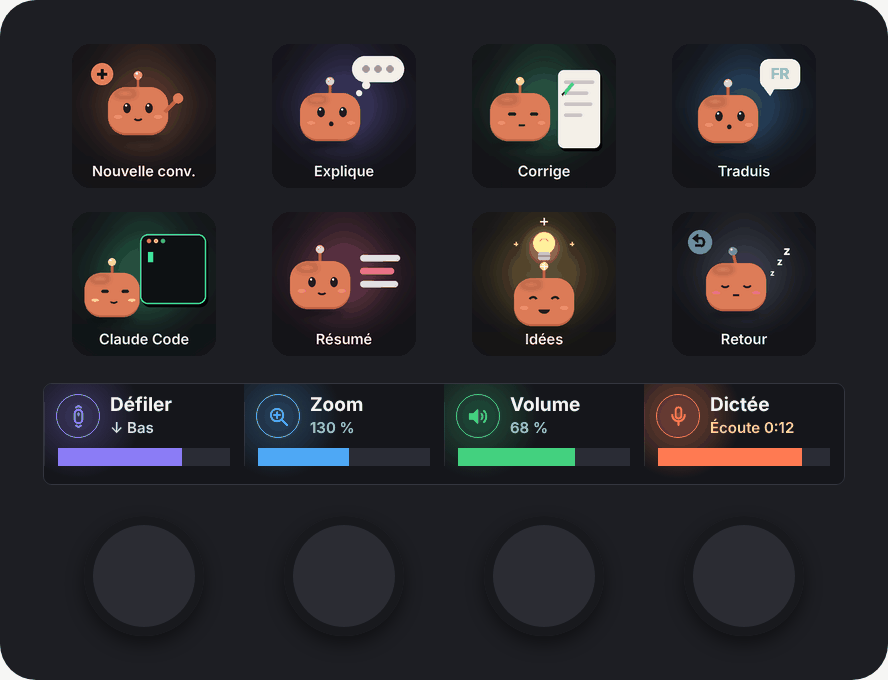
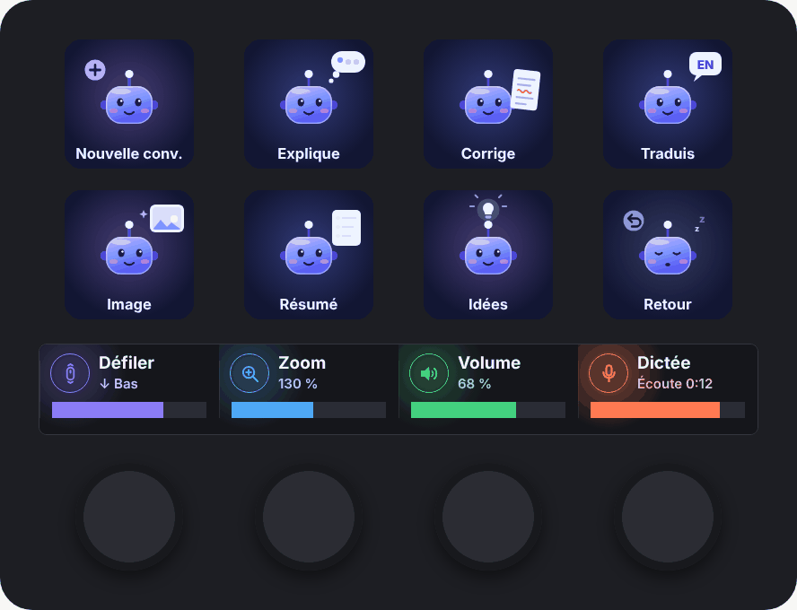
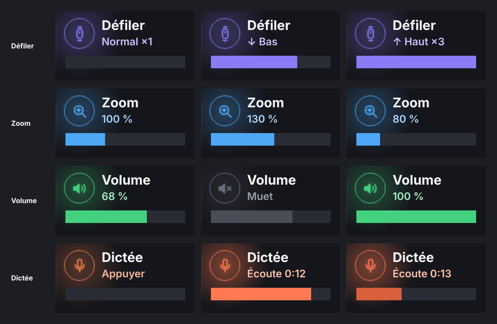
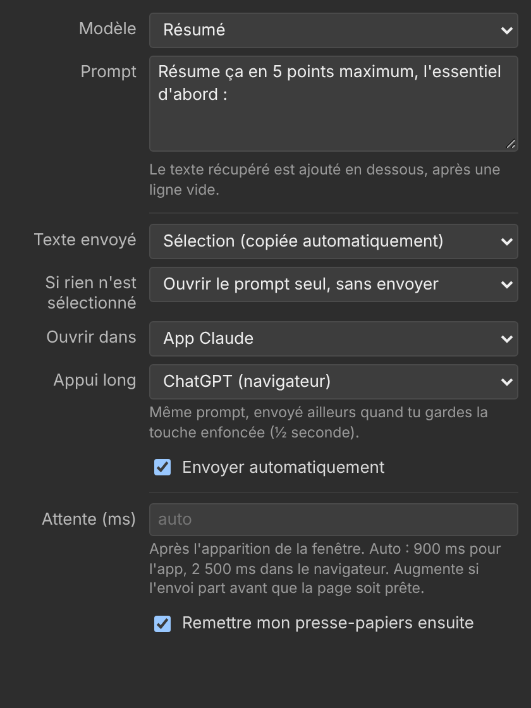

# IA Stream Deck

[](https://github.com/Foufou-exe/ia-streamdeck/actions/workflows/ci.yml)
[](https://github.com/Foufou-exe/ia-streamdeck/actions/workflows/codeql.yml)
[](https://github.com/Foufou-exe/ia-streamdeck/releases/latest)

[Français](README.md) · **English**

A **Stream Deck+** profile for working with **Claude** and **ChatGPT**: one page per assistant, keys that send your selection with a ready-made prompt, and dials with a large live bar.

| Claude page | ChatGPT page |
| :---: | :---: |
|  |  |

> Unofficial personal project, not affiliated with Anthropic or OpenAI. "Claude" and "ChatGPT" are trademarks of their respective owners. The mascots and icons are original artwork.
>
> The key labels, prompts and plugin interface are in French.

## Contents

- [Features](#features)
- [Installation](#installation)
- [Usage](#usage)
- [Customising a key](#customising-a-key)
- [Repository layout](#repository-layout)
- [Development](#development)
- [Known limitations](#known-limitations)
- [License](#license)

## Features

- **"Prompt IA" keys**: select some text anywhere, press a key, and the conversation opens with the prompt and your selection.
  - **Short press**: the assistant of the current page.
  - **Long press** (½ s): the other assistant, with the same prompt.
- **Two matching pages**: Claude (orange robot) and ChatGPT (blue-violet robot), each with 8 animated keys.
- **Large-bar dials**: the touch strip bar follows the dial live across the full width of the segment.
  - Scroll, Zoom, Volume and Dictation.
  - The displayed volume is the real Windows volume.
- **Clipboard preserved**: it is restored after every send.
- **No fixed delay**: the plugin waits for the window to be in the foreground before pasting or sending.



## Installation

**Requirements**

- A Stream Deck+.
- Windows 10 or 11.
- Stream Deck software 6.5 or later.
- For the Claude page: the Claude desktop app (`claude://` links).
- For the ChatGPT page: a web browser, since it opens chatgpt.com.

**Steps**

1. Download both files from the [latest release](https://github.com/Foufou-exe/ia-streamdeck/releases/latest):
   - `com.foufou-exe.profil-ia.streamDeckPlugin` (the plugin);
   - `Profil-IA.streamDeckProfile` (the profile).
2. Double-click the **plugin**, then click **Install**.
3. Double-click the **profile** and choose your Stream Deck+.
4. Select the **Profil IA** profile. Swipe the touch strip, or use the bottom-right key, to switch pages.

`SHA256SUMS.txt` in each release lets you check the downloaded files.

## Usage

### Keys

| Key | Claude page | ChatGPT page | Sending |
| --- | --- | --- | --- |
| Nouvelle conv. (new chat) | Empty conversation in the Claude app | Empty conversation on chatgpt.com | — |
| Explique (explain) | Simple explanation of the selection | same | you confirm |
| Corrige (proofread) | Fixes the text, keeping your tone | same | automatic |
| Traduis (translate) | FR ⇄ EN, natural tone | same | automatic |
| Claude Code / Image | Opens Claude Code | Generates an image from the selection | — / automatic |
| Résumé (summary) | 5 bullet points at most | same | automatic |
| Idées (ideas) | 5 original ideas | same | you confirm |
| Retour (back) | Next page (ChatGPT) | Previous page (Claude) | — |

After a press, the key shows a **check mark**: it's on its way. A **triangle** means nothing was selected, or the window did not open.

### Dials

| Dial | Turn | Press / touch |
| --- | --- | --- |
| Défiler (scroll) | Scrolls the page, the bar shows momentum | Speed ×1 / ×3 |
| Zoom | Ctrl + mouse wheel, 50 to 200 % | Back to 100 % (Ctrl + 0) |
| Volume | Real Windows volume | Mute / unmute |
| Dictée (dictation) | — | Windows voice typing (Win + H), with a timer |

## Customising a key

Click a key in the Stream Deck software: everything is set in the panel.



- **Modèle** (template): Explain, Summary, Proofread, Translate, Ideas, or **Personnalisé** (custom) to write your own prompt.
- **Texte envoyé** (text sent): the selection (copied automatically), the clipboard, or the prompt only.
- **Ouvrir dans** (open in): Claude app, claude.ai, Claude Code or ChatGPT. **Appui long** (long press) picks the other target.
- **Envoyer automatiquement** (send automatically): presses Enter once the text has arrived.
- **Attente** (wait): delay after the window opens. On automatic, it is 0.9 s for the app and 2.5 s in the browser.

## Repository layout

```
ia-streamdeck/
├── .github/                         CI, CodeQL, release and Dependabot
├── plugin/                          "Profil IA" Stream Deck plugin (Node.js)
│   ├── src/                         Source: plugin, PowerShell helper, prompts, panel
│   ├── com.foufou-exe.profil-ia.sdPlugin/   Plugin folder (images, layouts, UI)
│   ├── tools/render-plugin-assets.py     Renders the plugin images
│   ├── test/                        End-to-end test (fake Stream Deck)
│   └── build.js                     Build and .streamDeckPlugin archive
├── profils/
│   ├── profil-ia.json               Definition of both pages (keys, actions, settings)
│   ├── claude/touches/              Claude page GIFs (with / without text) and PNGs
│   └── chatgpt/touches/             ChatGPT page GIFs (with / without text) and PNGs
├── tools/
│   ├── build-profile.py             Builds the profile from profil-ia.json
│   ├── render-chatgpt-keys.py       Renders the ChatGPT keys
│   └── render-docs.py               Renders the images in this README
└── docs/images/                     Previews and mock-ups
```

Installable files are produced in `dist/` (ignored by Git) and published in the [Releases](https://github.com/Foufou-exe/ia-streamdeck/releases).

## Development

```bash
# Plugin
cd plugin
npm install
npm run pack      # build + dist/com.foufou-exe.profil-ia.streamDeckPlugin
npm test          # end-to-end test, no Stream Deck or Windows needed
npm run lint      # ESLint
npm run validate  # official Elgato validation (streamdeck CLI)

# Images and profile (Python 3.10+)
pip install -r tools/requirements.txt
python -m playwright install chromium
python plugin/tools/render-plugin-assets.py
python tools/render-chatgpt-keys.py
python tools/build-profile.py --pack   # + dist/Profil-IA.streamDeckProfile
python tools/render-docs.py
ruff check .                           # Python static analysis
```

**How it works.** The plugin talks to Stream Deck over WebSocket. To act on Windows, it starts a small PowerShell script (`helper.ps1`), with no native dependency, which handles:

- the volume (Core Audio API);
- the mouse wheel and keyboard shortcuts;
- the clipboard and foreground window detection.

The dials use a custom layout (172 × 18 px bar) instead of the native indicator.

The plugin log is in `%APPDATA%\Elgato\StreamDeck\Plugins\com.foufou-exe.profil-ia.sdPlugin\logs\`.

### Continuous integration and delivery

| Workflow | When | What it checks or does |
| --- | --- | --- |
| [CI](.github/workflows/ci.yml) | push to `main`, pull request | Commit messages, ESLint, npm audit, generated files up to date, end-to-end test, Elgato validation, PSScriptAnalyzer and PowerShell 5.1 syntax, Ruff, profile build, dependency review |
| [CodeQL](.github/workflows/codeql.yml) | push, pull request, every Monday | Security analysis of JavaScript, Python and workflows |
| [Release](.github/workflows/release.yml) | push to `main` | Version, changelog, tag and publishing of the installable files |
| [Dependabot](.github/dependabot.yml) | weekly | npm, pip and GitHub Actions updates |

**Commit messages.** The repository follows [Conventional Commits](https://www.conventionalcommits.org/); the version and changelog are derived from them.

| Prefix | Version bump | Changelog section |
| --- | --- | --- |
| `feat: …` | minor (1.**1**.0) | Nouveautés |
| `fix: …` | patch (1.0.**1**) | Corrections |
| `feat!: …` or a `BREAKING CHANGE:` footer | major (**2**.0.0) | ⚠ Breaking changes |
| `perf:`, `docs:`, `revert:` | patch | Performances, Documentation, Annulations |
| `chore:`, `ci:`, `build:`, `test:`, `refactor:`, `style:` | none | hidden |

**Cutting a release.** Nothing to do by hand:

1. Every push to `main` opens or updates a **`chore(main): release x.y.z`** PR with the new version and the [CHANGELOG](CHANGELOG.md) entries.
2. Merging that PR creates the `vX.Y.Z` tag and the GitHub release, then attaches `com.foufou-exe.profil-ia.streamDeckPlugin`, `Profil-IA.streamDeckProfile` and `SHA256SUMS.txt`.

The source of truth for the version is `plugin/package.json`; the plugin manifest (`x.y.z.0`) and the profile derive from it.

## Known limitations

- **Windows only**: the helper relies on PowerShell and Windows APIs.
- **Administrator windows**: windows started as administrator receive neither the mouse wheel nor the shortcuts (Windows limitation).
- **Zoom**: the displayed level is an estimate, since the plugin cannot read the application's actual zoom.
- **Dictation**: if you stop it other than with the dial, press once to resync the display.
- **ChatGPT link**: `chatgpt.com/?q=` pre-fills the input box. Its exact behaviour is up to OpenAI and may change.

## License

[MIT](LICENSE)
