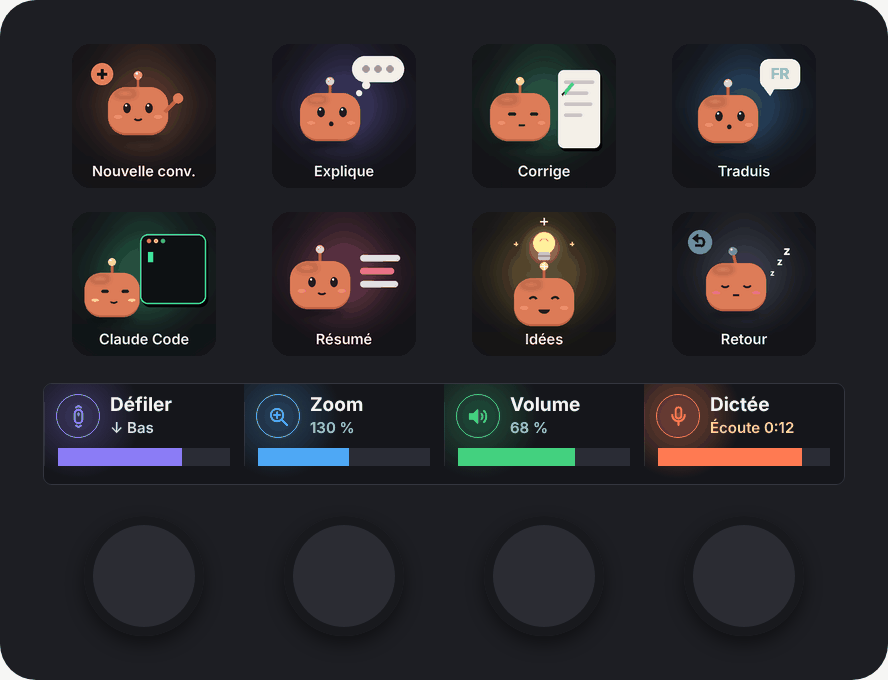
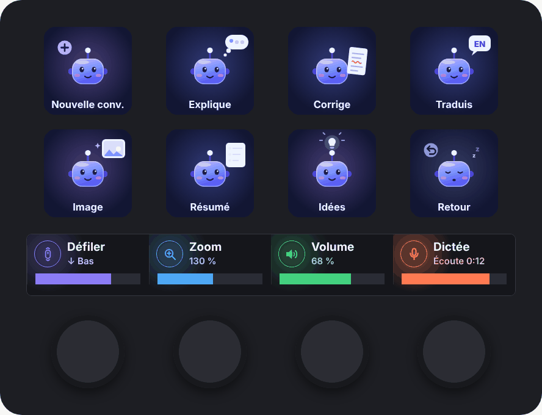
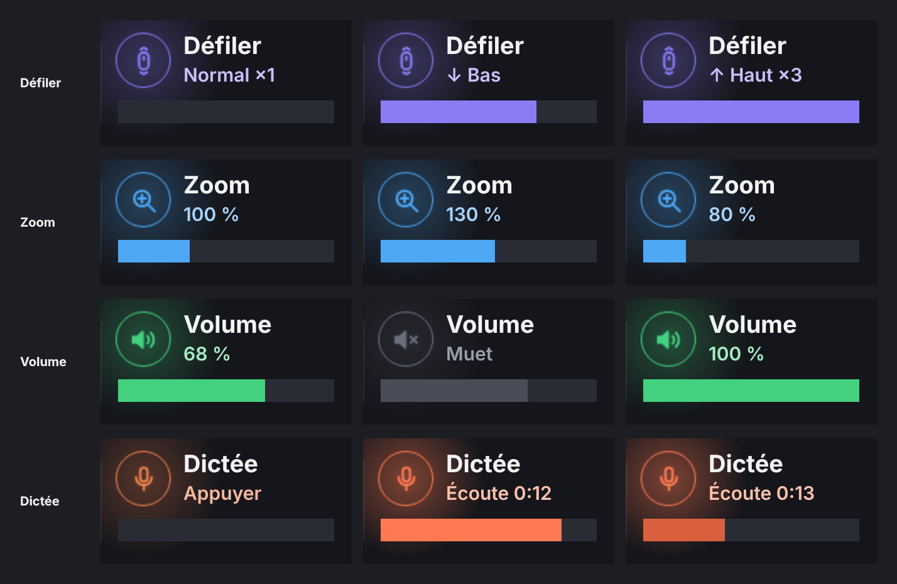
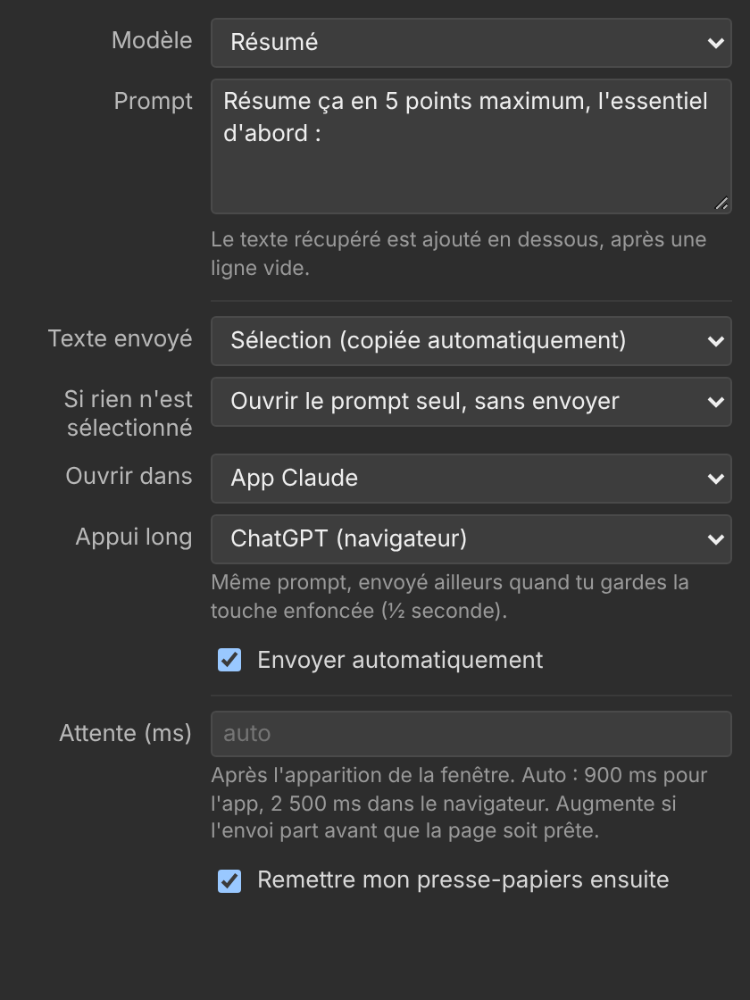

# IA Stream Deck

[](https://github.com/Foufou-exe/ia-streamdeck/actions/workflows/ci.yml)
[](https://github.com/Foufou-exe/ia-streamdeck/actions/workflows/codeql.yml)
[](https://github.com/Foufou-exe/ia-streamdeck/releases/latest)

**Français** · [English](README.en.md)

Profil **Stream Deck+** pour travailler avec **Claude** et **ChatGPT** : une page par assistant, des touches qui envoient ta sélection avec un prompt prêt à l'emploi, et des molettes à grande barre dynamique.

| Page Claude | Page ChatGPT |
| :---: | :---: |
|  |  |

> Projet personnel non officiel, sans lien avec Anthropic ni OpenAI. « Claude » et « ChatGPT » sont des marques de leurs propriétaires respectifs. Les mascottes et les icônes sont des créations originales.

## Sommaire

- [Fonctionnalités](#fonctionnalités)
- [Installation](#installation)
- [Utilisation](#utilisation)
- [Personnaliser une touche](#personnaliser-une-touche)
- [Structure du dépôt](#structure-du-dépôt)
- [Développement](#développement)
- [Limites connues](#limites-connues)
- [Licence](#licence)

## Fonctionnalités

- **Touches « Prompt IA »** : sélectionne un texte n'importe où, appuie, et la conversation s'ouvre avec le prompt et ta sélection.
  - **Appui court** : l'assistant de la page.
  - **Appui long** (½ s) : l'autre assistant, avec le même prompt.
- **Deux pages assorties** : Claude (robot orange) et ChatGPT (robot bleu-violet), chacune avec ses 8 touches animées.
- **Molettes à grande barre** : la barre de l'écran tactile suit la molette en direct sur toute la largeur du segment.
  - Défiler, Zoom, Volume et Dictée.
  - Le volume affiché est le vrai volume de Windows.
- **Presse-papiers préservé** : il est remis comme avant après chaque envoi.
- **Plus de délai fixe** : le plugin attend que la fenêtre soit au premier plan avant de coller ou d'envoyer.



## Installation

**Prérequis**

- Un Stream Deck+.
- Windows 10 ou 11.
- Le logiciel Stream Deck 6.5 ou plus récent.
- Pour la page Claude : l'application de bureau Claude (liens `claude://`).
- Pour la page ChatGPT : un navigateur, car elle ouvre chatgpt.com.

**Étapes**

1. Télécharge les deux fichiers de la [dernière version](https://github.com/Foufou-exe/ia-streamdeck/releases/latest) :
   - `com.foufou-exe.profil-ia.streamDeckPlugin` (le plugin) ;
   - `Profil-IA.streamDeckProfile` (le profil).
2. Double-clique sur le **plugin**, puis clique sur **Installer**.
3. Double-clique sur le **profil** et choisis ton Stream Deck+.
4. Sélectionne le profil **Profil IA**. Fais glisser l'écran tactile, ou utilise la touche en bas à droite, pour passer d'une page à l'autre.

## Utilisation

### Touches

| Touche | Page Claude | Page ChatGPT | Envoi |
| --- | --- | --- | --- |
| Nouvelle conv. | Conversation vide dans l'app Claude | Conversation vide sur chatgpt.com | — |
| Explique | Explication simple de la sélection | idem | tu valides |
| Corrige | Corrige en gardant ton ton | idem | automatique |
| Traduis | FR ⇄ EN, ton naturel | idem | automatique |
| Claude Code / Image | Ouvre Claude Code | Génère une image depuis la sélection | — / automatique |
| Résumé | 5 points maximum | idem | automatique |
| Idées | 5 idées originales | idem | tu valides |
| Retour | Page suivante (ChatGPT) | Page précédente (Claude) | — |

Après l'appui, la touche affiche une **coche** : c'est parti. Un **triangle** veut dire que rien n'était sélectionné, ou que la fenêtre ne s'est pas ouverte.

### Molettes

| Molette | Tourner | Appuyer / toucher |
| --- | --- | --- |
| Défiler | Défile la page, la barre montre l'élan | Vitesse ×1 / ×3 |
| Zoom | Ctrl + molette, niveau de 50 à 200 % | Retour à 100 % (Ctrl + 0) |
| Volume | Volume réel de Windows | Couper / rétablir |
| Dictée | — | Saisie vocale Windows (Win + H), avec chrono |

## Personnaliser une touche

Clique sur une touche dans le logiciel Stream Deck : tout se règle dans le panneau.



- **Modèle** : Explique, Résumé, Corrige, Traduis, Idées, ou **Personnalisé** pour écrire ton propre prompt.
- **Texte envoyé** : la sélection (copiée automatiquement), le presse-papiers, ou le prompt seul.
- **Ouvrir dans** : app Claude, claude.ai, Claude Code ou ChatGPT. **Appui long** choisit l'autre cible.
- **Envoyer automatiquement** : appuie sur Entrée une fois le texte arrivé.
- **Attente** : délai après l'ouverture de la fenêtre. En automatique, c'est 0,9 s pour l'app et 2,5 s dans le navigateur.

## Structure du dépôt

```
ia-streamdeck/
├── .github/                         CI, CodeQL, release et Dependabot
├── plugin/                          Plugin Stream Deck « Profil IA » (Node.js)
│   ├── src/                         Code source : plugin, helper PowerShell, prompts, panneau
│   ├── com.foufou-exe.profil-ia.sdPlugin/   Dossier du plugin (images, layouts, interface)
│   ├── tools/render-plugin-assets.py     Génère les images du plugin
│   ├── test/                        Test de bout en bout (faux Stream Deck)
│   └── build.js                     Build et archive .streamDeckPlugin
├── profils/
│   ├── profil-ia.json               Définition des deux pages (touches, actions, réglages)
│   ├── claude/touches/              GIF avec / sans texte et PNG de la page Claude
│   └── chatgpt/touches/             GIF avec / sans texte et PNG de la page ChatGPT
├── tools/
│   ├── build-profile.py             Construit le profil à partir de profil-ia.json
│   ├── render-chatgpt-keys.py       Génère les touches ChatGPT
│   └── render-docs.py               Génère les images de ce README
└── docs/images/                     Aperçus et maquettes
```

Les fichiers installables sont produits dans `dist/` (ignoré par Git) et publiés dans les [Releases](https://github.com/Foufou-exe/ia-streamdeck/releases).

## Développement

```bash
# Plugin
cd plugin
npm install
npm run pack      # build + dist/com.foufou-exe.profil-ia.streamDeckPlugin
npm test          # test de bout en bout, sans Stream Deck ni Windows
npm run lint      # ESLint
npm run validate  # validation officielle Elgato (CLI streamdeck)

# Images et profil (Python 3.10+)
pip install -r tools/requirements.txt
python -m playwright install chromium
python plugin/tools/render-plugin-assets.py
python tools/render-chatgpt-keys.py
python tools/build-profile.py --pack   # + dist/Profil-IA.streamDeckProfile
python tools/render-docs.py
ruff check .                           # analyse des scripts Python
```

### Intégration et livraison continues

| Workflow | Quand | Ce qu'il vérifie ou fait |
| --- | --- | --- |
| [CI](.github/workflows/ci.yml) | push sur `main`, pull request | Messages de commit, ESLint, audit npm, fichiers générés à jour, test de bout en bout, validation Elgato, PSScriptAnalyzer et syntaxe PowerShell 5.1, Ruff, build du profil, revue des dépendances |
| [CodeQL](.github/workflows/codeql.yml) | push, pull request, chaque lundi | Analyse de sécurité JavaScript, Python et workflows |
| [Release](.github/workflows/release.yml) | push sur `main` | Version, changelog, tag et publication des fichiers installables |
| [Dependabot](.github/dependabot.yml) | chaque semaine | Mises à jour npm, pip et GitHub Actions |

**Messages de commit.** Le dépôt suit [Conventional Commits](https://www.conventionalcommits.org/fr/) ; la version et le changelog en dépendent.

| Préfixe | Effet sur la version | Section du changelog |
| --- | --- | --- |
| `feat: …` | mineure (1.**1**.0) | Nouveautés |
| `fix: …` | correctif (1.0.**1**) | Corrections |
| `feat!: …` ou pied `BREAKING CHANGE:` | majeure (**2**.0.0) | ⚠ Changements majeurs |
| `perf:`, `docs:`, `revert:` | correctif | Performances, Documentation, Annulations |
| `chore:`, `ci:`, `build:`, `test:`, `refactor:`, `style:` | aucune | masqué |

**Publier une version.** Rien à faire à la main :

1. Chaque push sur `main` ouvre ou met à jour une PR **`chore(main): release x.y.z`** qui contient la nouvelle version et les entrées du [CHANGELOG](CHANGELOG.md).
2. Fusionner cette PR crée le tag `vX.Y.Z` et la release GitHub, puis y joint `com.foufou-exe.profil-ia.streamDeckPlugin`, `Profil-IA.streamDeckProfile` et `SHA256SUMS.txt`.

La version de référence est celle de `plugin/package.json` ; le manifest du plugin (`x.y.z.0`) et le profil en dérivent.

**Comment ça marche.** Le plugin parle à Stream Deck par WebSocket. Pour agir sur Windows, il lance un petit script PowerShell (`helper.ps1`), sans dépendance native, qui gère :

- le volume (API Core Audio) ;
- la molette et les raccourcis clavier ;
- le presse-papiers et la détection de la fenêtre au premier plan.

Les molettes utilisent une mise en page personnalisée (barre de 172 × 18 px) au lieu de l'indicateur natif.

Le journal du plugin se trouve dans `%APPDATA%\Elgato\StreamDeck\Plugins\com.foufou-exe.profil-ia.sdPlugin\logs\`.

## Limites connues

- **Windows uniquement** : le helper repose sur PowerShell et les API Windows.
- **Fenêtres administrateur** : celles lancées en administrateur ne reçoivent ni la molette ni les raccourcis (limitation Windows).
- **Zoom** : le niveau affiché est une estimation, car le plugin ne connaît pas le zoom réel de l'application.
- **Dictée** : si tu l'arrêtes autrement qu'avec la molette, appuie une fois pour resynchroniser l'affichage.
- **Lien ChatGPT** : `chatgpt.com/?q=` pré-remplit la zone de saisie. Son comportement exact dépend d'OpenAI et peut changer.

## Licence

[MIT](LICENSE)
